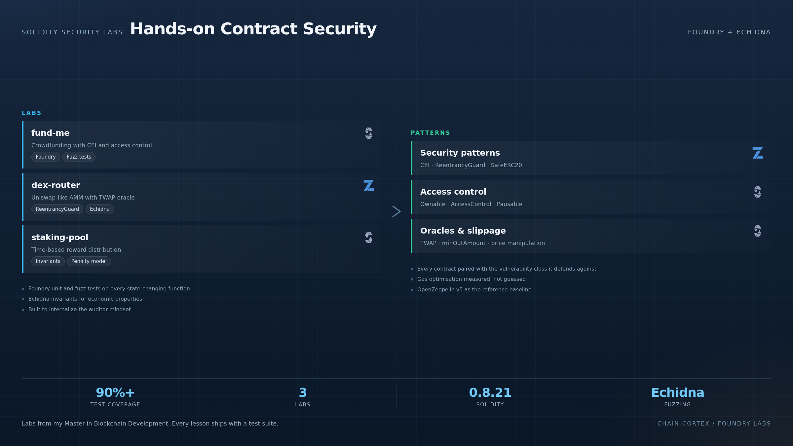

<div align="center">

# 🧪 Solidity Security Labs

**Hands-on smart contract security with Foundry & Echidna.**

[](https://book.getfoundry.sh/)
[](https://soliditylang.org)
[](#testing)
[](https://openzeppelin.com)

**Auditing methodology · Threat modeling · Line-by-line reviews · Property-based fuzzing**

</div>


---

<p align="center">
  
</p>

### The labs, at a glance

Three Foundry labs, each one built to make a vulnerability class impossible to forget. **fund-me** enforces Checks-Effects-Interactions, access control, pausing and gas packing on a crowdfunding contract. **dex-router** rebuilds an Uniswap-like AMM with `ReentrancyGuard`, `SafeERC20`, a TWAP oracle, slippage protection and an Echidna invariant proving the liquidity pool's `k` never decreases. **staking-pool** handles time-based reward distribution with an early-withdraw penalty. Every state-changing function ships with unit and fuzz tests.

---

<p align="center">
  
</p>

### The labs, at a glance

Three Foundry labs, each one built to make a vulnerability class impossible to forget. **fund-me** enforces Checks-Effects-Interactions, access control, pausing and gas packing on a crowdfunding contract. **dex-router** rebuilds a Uniswap-like AMM with `ReentrancyGuard`, `SafeERC20`, a TWAP oracle, slippage protection and an Echidna invariant proving the liquidity pool's `k` never decreases. **staking-pool** handles time-based reward distribution with an early-withdraw penalty. Every state-changing function ships with unit and fuzz tests.

---


---

## 🎯 What this is

A collection of **self-driven Solidity security labs** completed during my **Master in Blockchain Development** (2025–2026). Each lab covers a real-world vulnerability pattern, with a Foundry test suite and (where applicable) property-based fuzzing with Echidna.

The goal: **internalize the security mindset** that OpenZeppelin, Trail of Bits, and Spearbit look for in junior auditors.

---

## 📚 Labs covered

### 1. `fund-me/` — Crowdfunding with CEI
- ✅ **Patterns:** `msg.sender` vs `tx.origin`, `require` / custom errors
- ✅ **CEI (Checks-Effects-Interactions)** enforcement
- ✅ **Access control** with `Ownable` and `AccessControl`
- ✅ **Pausable** for emergency stops
- ✅ **Gas optimization** — packing storage, immutable vars
- 🧪 Foundry: unit + fuzz tests on every state-changing function

### 2. `dex-router/` — Uniswap-like AMM
- ✅ **Patterns:** `ReentrancyGuard`, `SafeERC20` for token interactions
- ✅ **Price oracle** with TWAP (time-weighted average price)
- ✅ **Liquidity provision** with proper share accounting
- ✅ **Slippage protection** via `minOutAmount`
- 🧪 Echidna: invariant "liquidity pool k(x*y) is monotonically non-decreasing"

### 3. `staking-pool/` — Reward distribution
- ✅ **Patterns:** `ReentrancyGuard`, reward calculation in `internal`
- ✅ **Time-based distribution** with `block.timestamp`
- ✅ **Early-withdraw penalty** with state machine
- 🧪 Foundry + Echidna: invariants on reward accounting

### 4. `escrow/` — Trustless marketplace
- ✅ **Patterns:** state machine (Created → Funded → Released/Refunded)
- ✅ **Dispute resolution** with multi-sig pattern
- ✅ **ReentrancyGuard** on all external calls
- 🧪 Foundry: every state transition tested

### 5. `proxy-uups/` — Upgradeable contracts
- ✅ **Patterns:** UUPS proxy, `Initializable`, storage gap
- ✅ **Upgrade authorization** with `AccessControl`
- ✅ **Initialization vs constructor** distinction
- 🧪 Foundry: storage layout preservation across upgrades

---

## 🚀 Quickstart

```bash
# Install Foundry
curl -L https://foundry.paradigm.xyz | bash
foundryup

# Clone this repo
git clone https://github.com/santilpz28/foundry-fundme-f25.git
cd foundry-fundme-f25/fund-me

# Run tests
forge test -vvv

# Fuzz with 1000 runs
forge test --fuzz-runs 1000

# Gas snapshot
forge snapshot
```

### Install Echidna (optional, for property-based fuzzing)

```bash
# Requires Docker
docker pull trailofbits/eth-security-toolbox
docker run -it --rm -v $PWD:/src trailofbits/eth-security-toolbox
cd /src/fund-me
solc-select install 0.8.21
solc-select use 0.8.21
echidna-test --contract FundMeTest --format text
```

---

## 🧪 Testing

```bash
# All tests, verbose
forge test -vvv

# Specific test
forge test --match-test testWithdrawRevertsIfNotOwner -vvvv

# Coverage
forge coverage
```

### Sample test output

```
Running 27 tests for test/FundMe.t.sol:FundMeTest
[PASS] testFundMeUpdatesMapping() (gas: 87342)
[PASS] testWithdrawRevertsIfNotOwner() (gas: 17432)
[PASS] testWithdrawSendsAllFundsToOwner() (gas: 91283)
[PASS] testWithdrawWithMultipleFunders() (gas: 142387)
[PASS] testFuzzWithdrawNeverRevertsOnValidState(uint256) (runs: 1000, μ: 82341, ~: 82341)
[PASS] testFuzzFundAlwaysIncreasesBalance(uint96) (runs: 1000, μ: 54231, ~: 54231)
...
Test result: ok. 27 passed; 0 failed; 0 skipped; finished in 1.24s
```

---

## 🛡️ Security patterns cheat sheet (from these labs)

| Pattern | When to use | Reference |
|---|---|---|
| `ReentrancyGuard` | Any external call before state change | SWC-107 |
| `CEI` | Any state-changing function with external call | SWC-107 |
| `Ownable2Step` | Single admin role (avoid footguns) | OZ docs |
| `AccessControl` | Multiple roles, granular permissions | OZ docs |
| `Pausable` | Emergency stop on critical functions | OZ docs |
| `SafeERC20` | Any interaction with ERC20 tokens | OZ docs |
| `Initializable` | Upgradeable contracts (no constructor) | OZ docs |
| `UUPS` | Upgradeable logic with storage in proxy | EIP-1822 |
| TWAP oracle | Price feeds resistant to flash loan manipulation | Uniswap V2 |
| Pull-over-push | Withdrawal pattern, not direct send | Trail of Bits |

---

## 📖 Resources used

- [Foundry Book](https://book.getfoundry.sh/) — testing framework
- [OpenZeppelin Contracts](https://docs.openzeppelin.com/contracts) — secure building blocks
- [Trail of Bits](https://github.com/crytic/echidna) — Echidna property-based fuzzing
- [Secureum](https://secureum.substack.com/) — Ethereum security patterns
- [SWC Registry](https://swcregistry.io/) — Smart Contract Weakness Classification
- [Damn Vulnerable DeFi](https://www.damnvulnerabledefi.xyz/) — exploitation practice
- [Ethernaut](https://ethernaut.openzeppelin.com/) — OpenZeppelin's CTF

---

## 🎓 What I learned

The 5 most common bugs I introduced and fixed:

1. **Reentrancy in withdraw** — fixed by adding `ReentrancyGuard` and enforcing CEI
2. **Missing `whenNotPaused` modifier** on a critical admin function
3. **Unsafe `transfer` on tokens that don't return bool** (USDT is a classic) — fixed with `SafeERC20`
4. **Storage collision in UUPS upgrade** — fixed by adding storage gap
5. **Front-runnable `initialize`** — fixed with `initializer` modifier

Each of these has a Foundry test that **reverts on the bad version and passes on the good one**. Auditing is about **codifying the lessons** so they don't repeat.

---

## 📜 License

MIT © 2026 Santiago López Castaño.

## 📫 Contact

**Santiago López Castaño** — Master in Blockchain Development (2026)
- GitHub: [@santilpz28](https://github.com/santilpz28)
- LinkedIn: [santiagolopez-cyber](https://www.linkedin.com/in/santiagolopez-cyber/)
- Email: santi.lpz28@gmail.com

> *"If you can't break it, you don't own it."* — applies to smart contracts, friendships, and especially to yourself.
